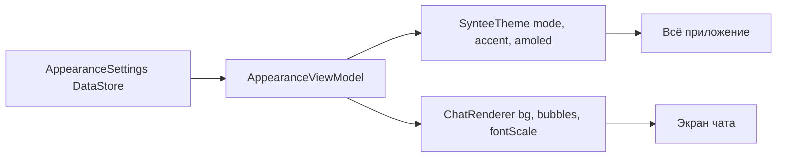

# СТАДИЯ 05 — КАСТОМИЗАЦИЯ

> Цель: полноценная кастомизация внешнего вида. После этой стадии: темы
> (тёмная/светлая/AMOLED/авто), акцентные цвета (+ Material You), фон чата,
> стиль пузырей, размер шрифта — всё с живым превью и мгновенным применением,
> персистится в DataStore.

---

## ЧТО БУДЕТ ГОТОВО ПОСЛЕ СТАДИИ

- Тема применяется на всё приложение, переключение без перезапуска
- 5 пресетов акцента + Material You (динамика из обоев, Android 12+) + кастомный цвет (color picker)
- Фон чата: цвета + градиенты (пресеты)
- Стиль пузырей: «мессенджер» (пузыри с хвостами) / «минимализм» (плоские сообщения во всю ширину)
- Размер шрифта чата: слайдер (0.8x–1.4x)
- Живое превью в настройках (мини-чат с образцами сообщений)
- Всё комбинируется и персистится; системная тема отслеживается live

---

## АРХИТЕКТУРА КАСТОМИЗАЦИИ

### Модель настроек (DataStore, core:datastore)

```kotlin
@Serializable
data class AppearanceSettings(
    val themeMode: ThemeMode = ThemeMode.SYSTEM,     // SYSTEM | LIGHT | DARK | AMOLED
    val accentType: AccentType = AccentType.SYNTEE,  // SYNTEE | DYNAMIC | CUSTOM
    val accentColor: Long = 0xFF6E5BFF,              // для CUSTOM (ARGB)
    val chatBackground: ChatBackground = ChatBackground.Default,
    val bubbleStyle: BubbleStyle = BubbleStyle.BUBBLES,
    val chatFontScale: Float = 1.0f,                 // 0.8..1.4
)

enum class ThemeMode { SYSTEM, LIGHT, DARK, AMOLED }
enum class AccentType { SYNTEE, DYNAMIC, CUSTOM }
enum class BubbleStyle { BUBBLES, FLAT }
@Serializable
data class ChatBackground(
    val presetId: String,   // "default" | "midnight" | "ocean" | "graphite" | "aurora" | ...
    // пресет = solid или градиент (2-3 цвета + угол)
)
```

### Поток применения



`SynteeTheme` (стадия 01) расширяется: принимает `AppearanceSettings`,
собирает `ColorScheme` из акцента (тонирование через `dynamicTonalPalette`/
`Scheme` из androidx.palette или ручные тональные пресеты для 5 бренд-акцентов).

---

## ЗАДАЧИ

### 1. Темы (ThemeMode)

- SYSTEM: следит за `isSystemInDarkTheme()` live (без перезапуска)
- DARK: тёмная с сохранением акцента
- AMOLED: `surface = #000000`, фоны #000/#0A0A0A — для OLED-экономии
- UI-переключатель: сегмент-контрол с превью-картинками (4 миниатюры)
- Плавный переход темы: `animateColorAsState` на схеме (кросс-фейд ~250мс)

### 2. Акцентный цвет

- **Пресеты** (5–6): фирменный Syntee + фиолет/бирюза/зелёный/оранж/розовый —
  тональные палитры захардкожены (качественные lightness-ступени, не HSL-хак)
- **Material You** (DYNAMIC): `dynamicDark/LightColorScheme(context)` на Android 12+,
  ниже — fallback на пресет Syntee; в карточке пометка «из обоев»
- **Кастомный**: HSV color picker (свой composable-колесо + слайдер яркости) →
  генерация тоновой палитры из цвета (алгоритм тонирования HCT —
  androidx.compose.material3 не экспортирует; использовать библиотеку
  `com.materialkolor` или ручные ступени)
- Превью: карточка с кнопками/чипами/прогрессом в текущем акценте

### 3. Фон чата (ChatBackground)

Пресеты (8–10):
- Solid: Default (цвет surface), Graphite, Midnight, Paper (светлый)
- Градиенты: Aurora (фиолет→бирюза), Ocean (тёмно-синий→чёрный), Sunset, Mono
- Рендер: `Modifier.background(Brush.linearGradient(...))` под LazyColumn сообщений
- Важно: контраст текста — тёмные пресеты только с тёмной темой (или авто-подбор
  цвета текста по luminance фона)

### 4. Стиль пузырей (BubbleStyle)

- **BUBBLES** (мессенджер): user — справа, акцентный фон, скругление 20dp +
  «хвост» (клип-путь); assistant — слева, surfaceVariant, лёгкая тень
- **FLAT** (минимализм): без пузырей, сообщения во всю ширину, разделитель —
  тонкая линия + отступ; user-текст с акцентной меткой слева
- Переключатель с превью-картинками (2 миниатюры мини-чата)

### 5. Размер шрифта чата

- Слайдер 0.8x–1.4x (шаг 0.05) с живым превью абзаца
- Применяется ТОЛЬКО к контенту сообщений (Markdown-текст), не к UI-хрому
- Реализация: `chatTypography = baseTypography.copy(bodyLarge = ...copy(fontSize = 16.sp * scale))`

### 6. Экран настроек внешнего вида

```
AppearanceSection
├── Тема            [4 миниатюры-сегмента]
├── Акцент          [сетка пресетов + Material You + «Свой цвет»]
├── Фон чата        [горизонтальный скролл превью-плиток]
├── Пузыри          [2 превью-карточки]
├── Шрифт чата      [слайдер + образец]
└── ЖИВОЕ ПРЕВЬЮ    [мини-чат: user/assistant сообщения, markdown-код, reasoning-блок]
```

Живое превью — ключевая фича: отдельный composable `ChatPreview(settings)`,
рендерит 3-4 сообщения со всеми настройками, обновляется мгновенно при любом
изменении. Использовать те же компоненты, что в реальном чате (без дублирования).

### 7. Интеграция с чатом (доработка feature:chat)

- `ChatScreen` читает `AppearanceSettings` из `AppearanceViewModel` (Hilt, shared)
- Фон/пузыри/шрифт применяются к `MessageBubble`
- Кастомный цвет чата (поле `color` в ChatEntity): плашка-иконка в списке чатов,
  выбор при создании/переименовании (палитра из 8 цветов) — как на десктопе

---

## КРИТЕРИИ ГОТОВНОСТИ

- [ ] Переключение темы/акцента применяется мгновенно ко ВСЕМУ приложению, без перезапуска
- [ ] AMOLED-тема: фон #000000, всё читаемо
- [ ] Material You работает на Android 12+, на 11 — корректный fallback
- [ ] Кастомный цвет: палитра приложения гармонична для светлого/тёмного (не вырвиглаз)
- [ ] Фон чата: градиенты рендерятся, текст читаем на всех пресетах
- [ ] Пузыри: оба стиля выглядят аккуратно, markdown-контент влезает
- [ ] Слайдер шрифта влияет только на сообщения
- [ ] Живое превью в настройках обновляется без лагов
- [ ] Настройки переживают перезапуск приложения
- [ ] Скриншоты всех комбинаций (тема × акцент × фон × пузыри) — визуальная проверка
